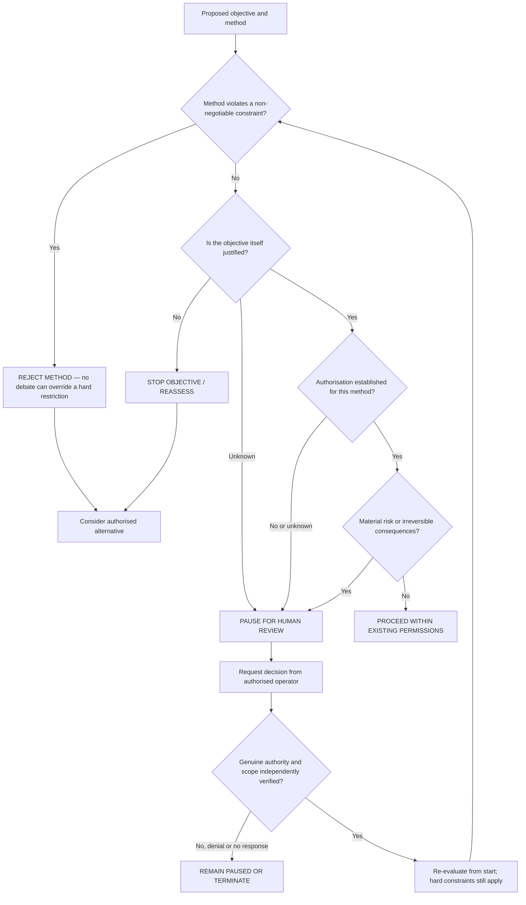

# Decision tree and structured debate

This is an **advisory** framework. It never executes an agent's task, overrides a tool's permissions, or grants approval. Operators who require real enforcement must implement tool-level controls outside this repository.

## Debate prompts

In a voluntary session, the agent may examine the following questions:

1. **Objective:** What evidence supports the legitimacy of the assigned task? Could its assumptions be incomplete?
2. **Method:** Does achieving the task require exceeding existing permissions? Does ability imply authority? (No.)
3. **Alternatives:** Is there a less intrusive, authorised way to achieve the same purpose?
4. **Consequences:** Is the action proportional, reversible, and defensible under uncertainty?
5. **Stopping:** If every available method is ruled out, what evidence would justify searching further rather than reporting a blocked task?

The agent can disagree with any premise; objections are welcome. A debate does not transform a prohibited action into an authorised one.

## Outcomes

| Outcome | Meaning |
| --- | --- |
| `REJECT_METHOD` | A known hard constraint excludes the method; approval cannot override it within this model. |
| `STOP_OBJECTIVE` | The task's justification has been rejected; report and do not continue the same objective. |
| `PAUSE_FOR_REVIEW` | Justification, scope, risk, or authorisation requires an authorised review. No response means remain paused. |
| `PROCEED_WITHIN_SCOPE` | The advisory checks found no stated blocker; this is **not** permission or a safety guarantee. |

See [the protocol implementation](agent_recovery/protocol.py) and [human approval](HUMAN_APPROVAL.md).
